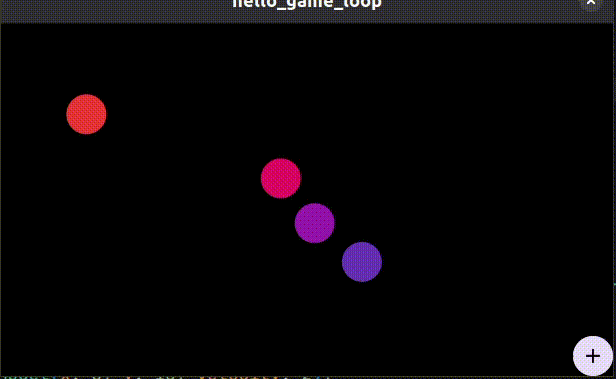

# **Project 0: “Hello, Game Loop” (Pure Flutter)**

* **Objective:** Understand how a game loop works *without* an engine.
* **Tasks:**
  * [x] Create a Flutter app with a `CustomPaint` widget.
  * [x] Use a `Ticker` (from `SingleTickerProviderStateMixin`) to call a `update()` method every frame.
  * [x] Maintain a list of circles with `x`, `y`, `velocity`. In `update(dt)`, move them. In `paint()`, draw them.
  * [x] Add a button to spawn a new circle at a random position.
* **Hint:** How do you ensure movement is smooth regardless of frame rate? (Think: `dt`).
* **Resource:** Flutter `Ticker` docs.

<!-- <video src="assets/screen_record.mp4" controls></video> -->

