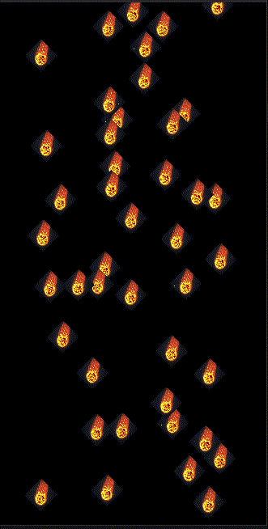

# meteor_shower

## Project 1: “Meteor Shower” (Components & Randomness)

* **Objective:** Learn the component tree and lifecycle.
* **Tasks:**
  * [x] Create a `FlameGame` and add it to the widget tree.
  * [x] Create a `Meteor` class extending `PositionComponent` (or `SpriteComponent`).
  * [x] In `onLoad`, spawn meteors at random x-positions above the screen.
  * [x] In `update(dt)`, move them down. Remove them when off-screen.
* **Hint:** How does a component know it has been added to the game? What is `removeFromParent()`?
* **Resource:** Google Codelab: *Introduction to Flame with Flutter* (covers GameWidget, game loop, and components).

