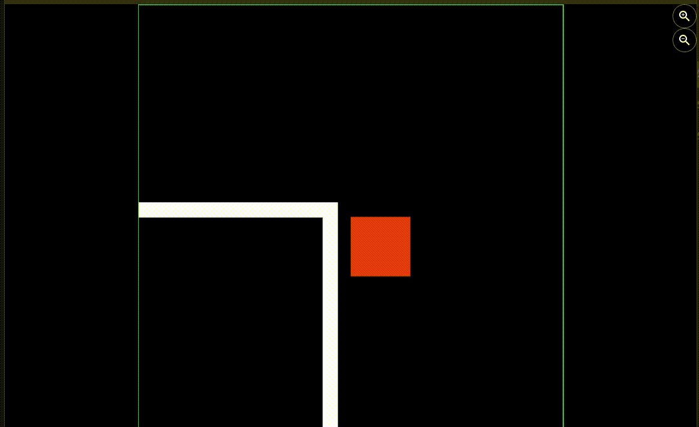

# Project 3: Top-Down Walker

* **Objective:** Implement a camera that follows a player and zooms.
* **Tasks:**
  * [x] Create a large world (e.g., a big rectangle) and a small player square.
  * [x] Add a `CameraComponent` and a `World`. Make the camera follow the player smoothly (use `camera.follow(player)`).
  * [x] Add two UI buttons (Flutter `Overlay` widgets) to call `camera.viewfinder.zoomTo(...)` for zoom in/out.
* **Hint:** What is the relationship between the `World` and the `CameraComponent`? Why doesn't the UI zoom with the world?
* **Resource:** Flame docs: *Camera & Viewport*.

